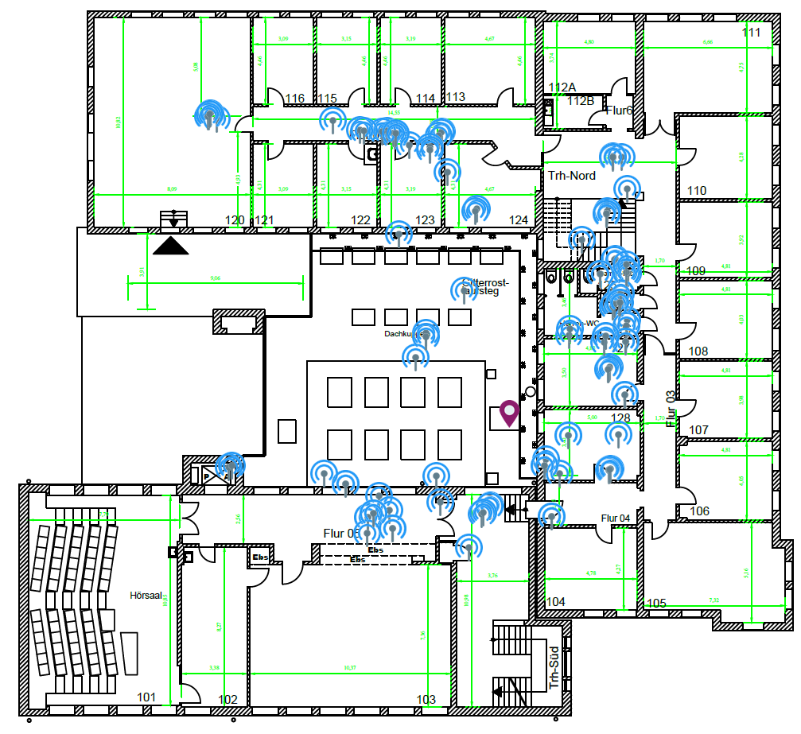
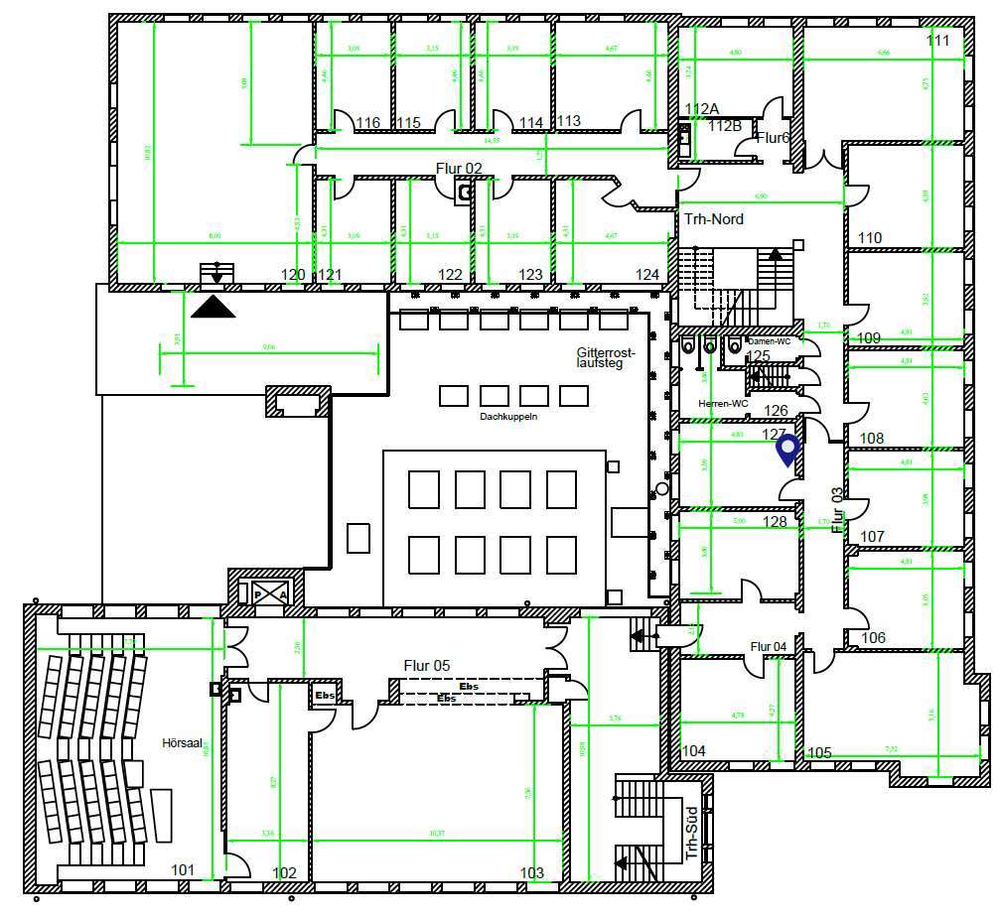
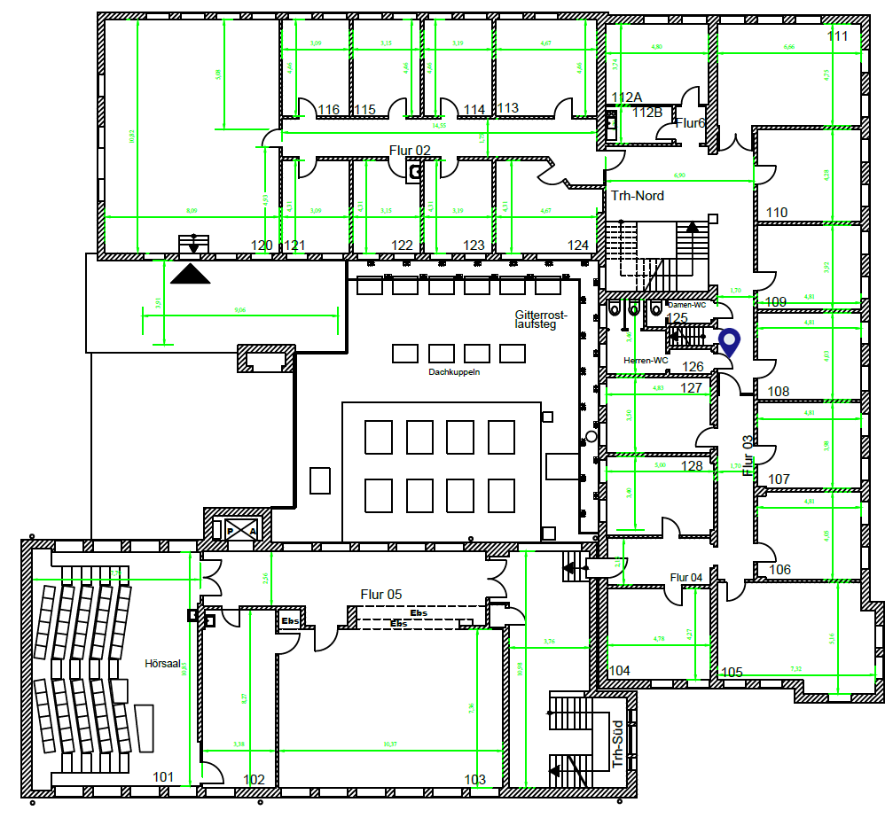
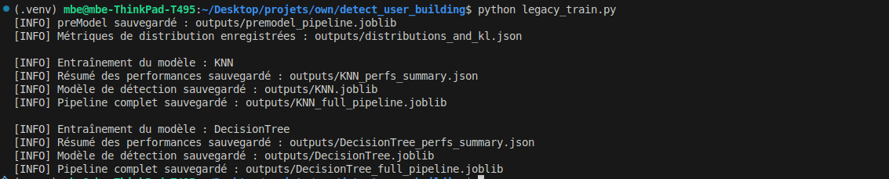
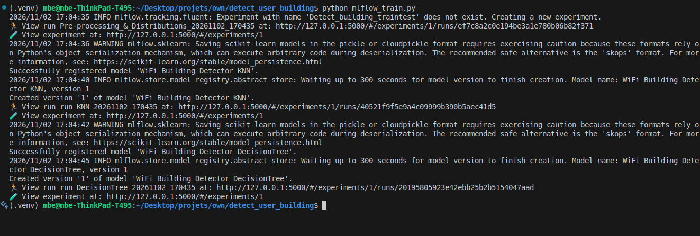
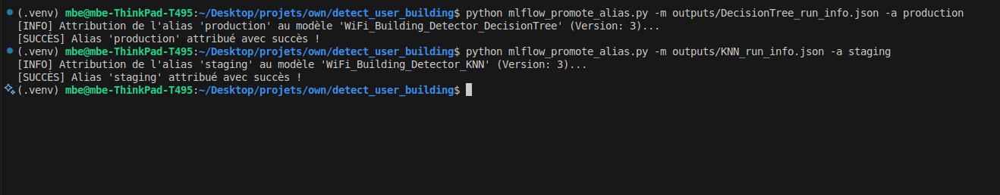
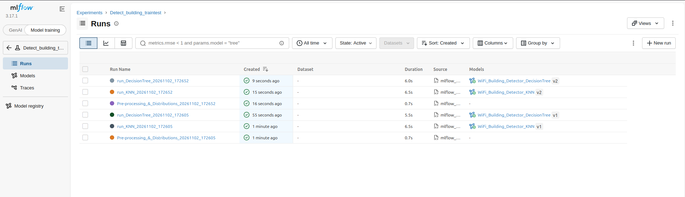
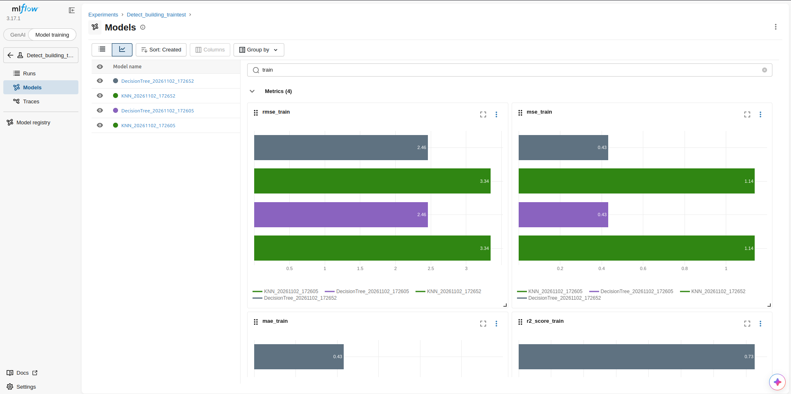
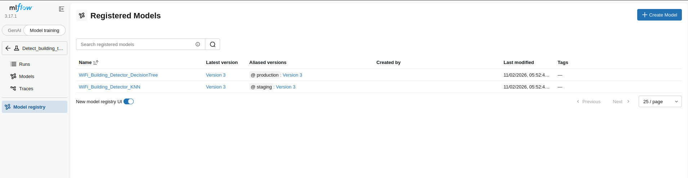

# detect_user_building

Grâce aux points d'accès d'un bâtiment, on souhaite qu'un usager puisse connaître où il se trouve dans ce bâtiment.
Ce projet vise à résoudre ce problème, quelle que soit la dimension avec laquelle on voit le bâtiment.

Il est donc nécessaire d'avoir :

- le plan du bâtiment
- l'échelle du bâtiment (où réaliser les calculs)

## Approches

Considérons qu'on a relevé leurs signaux à des positions données

- On essaye d'estimer les positions des points d'accès, avant de calculer la position de l'usager :expressionless:
")


- On cherche les positions (de zones collectées) les plus proches :smile:
")


- On utilise un modèle d'apprentissage artificielle (de régression) entrainé pour prédire la position de l'usager :fire:
")


## Prérequis

- **Python** : 3.14+
- **Git** : pour récupérer le projet
- **Accès au stockage DVC** : le remote configuré (`.dvc/config`) pointe actuellement vers le repertoire local `/tmp/dvcstore`. Adaptez-le avec `dvc remote modify myremote url <votre_remote>` pour un acces distant

## Structure du projet

```text
detect_user_building/
├── requirements.txt           # dépendances Python
├── building_config.json       # configuration du bâtiment (plan, curseur, échelle)
├── main.py                    # script d'utilisation de la detection dans le dit batiement
├── collect.py                 # collecte des signaux
├── check_cpu.py               # informations sur le CPU
│
├── main.ipynb                 # notebook de test des algorithmes (sans IA) (à lire)
├── ml.ipynb                   # notebook d'entrainement et de test du modèle (à lire)
│
├── legacy_train.py            # entrainement classique
├── legacy_inference.py        # inférence classique
├── mlflow_train.py            # entrainement avec suivi MLflow
├── mlflow_inference.py        # inférence depuis un modèle MLflow
├── mlflow_promote_alias.py    # promotion d'un modèle (production / staging)
│
├── src/                       # fonctions de calcul de la position
│   ├── detect_access_points.py  # estimation des positions des points d'accès
│   ├── detect_position.py       # recherche des zones les plus proches
│   ├── detect_user.py           # détection de l'usager
│   ├── distributions.py         # distributions et divergence KL
│   ├── load.py / save.py        # chargement / sauvegarde des données
│   ├── perfs.py                 # évaluation des performances
│   ├── plot.py                  # visualisations
│   └── optimisation/            # descente de gradient
│
├── datas/                     # signaux collectés (csv, json)
│   ├── with_acces/            # données avec positions des points d'accès connues
│   └── without_acces/         # données sans positions des points d'accès
├── outputs.dvc                # empreinte DVC du dossier outputs
├── images/                    # images (plan, captures)
├── documentation/             # rapports du projet (PDF)
└── .dvc/                      # configuration DVC
```

## Installation

- Créer et activer l'environnement virtuel

```bash
python3 -m venv .venv
source .venv/bin/activate   # Windows (WSL) : idem
```

- Installer les dépendances

```bash
pip install --upgrade pip
pip install -r requirements.txt
pip install dvc
```

- Récupérer les modèles et sorties versionnés avec DVC

```bash
dvc pull
```

## Machin Learning

### Entrainement / Experiences et inferences

- activation de l'environement virtuelle

```bash
source .venv/bin/activate
```

- en legacy

```bash
# entrainement train - test
python3 legacy_train.py
# python3 legacy_train.py --help pour avoir de l'aide

# inference
python3 legacy_inference.py
# python3 legacy_inference.py --help pour avoir de l'aide
```

- avec mlflow

```bash
# lancement du serveur (si cen'est pas encore fait dans un terminal a part)
mlflow server

# entrainement train - test
python3 mlflow_train.py
# python3 mlflow_train.py --help pour avoir de l'aide

# inference
python3 mlflow_inference.py
# python3 mlflow_inference.py --help pour avoir de l'aide

```

- Promotion d'un modele entrainee dans MLFlow en production ou en stagging

```bash
# en production
python mlflow_promote_alias.py -m outputs/DecisionTree_run_info.json -a production
# en staging
python mlflow_promote_alias.py -m outputs/KNN_run_info.json -a staging

# python mlflow_promote_alias.py --help pour avoir l'aide
```

### Captures

- Entrainements
  
  

- promotions MLFlow : etiquetage pour un environement (production / staging)
  

- les runs d'entrainements de MLFlow
  

- les modeles de MLFlow
  

- registre des modeles de MLFlow
  

### gestion de parametres obtenues avec dvc

```bash
# chargement des donnees depuis la source de donnees distance
dvc pull

# calcul du fichier empreintes des repertoires des poids outputs.dvc
dvc add outputs

# envoie les donnees du repertoires outputs, s'il y'a changement entre l'ancien fichier .dvc et le nouveau
dvc push
```
